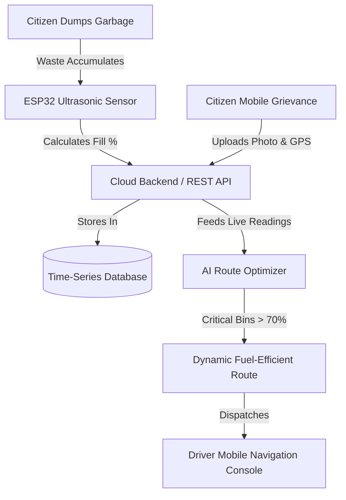

# 📊 Dataset & Real-Time Data Architecture — Presentation Guide

> **Quick Summary for Evaluator / External Examiner:**  
> EcoRoute AI is an **IoT-driven dynamic telemetry & participatory sensing system**. Rather than relying on static, outdated offline CSV files, it generates and consumes **live, time-series operational municipal data** from smart dustbins and citizens in real-time.

---

## 🎤 1. The 30-Second Elevator Pitch (What to say to Ma'am)

> *"Ma'am, standard machine learning projects often take an old CSV file from Kaggle and train a model offline.  
> However, for real-world smart city waste management, a garbage truck cannot collect waste today using static data from last year.  
> **Our project operates on LIVE real-time telemetry data.** When a citizen dumps garbage, our ESP32 ultrasonic sensor immediately detects the change in depth, calculates the fill percentage, and streams this data to our cloud database. This live data drives our dynamic AI route optimization algorithm."*

---

## ❓ 2. Common Questions & Ready-Made Answers

### Q1: *"Does this project require a pre-existing dataset?"*
**Answer:**  
*"No pre-existing static CSV is required because our system is a **real-time streaming IoT data pipeline**. It continuously collects, processes, and logs live operational field data. However, the system archives every sensor pulse and collection event into a **historical time-series dataset** in our database for predictive analytics and municipal reporting."*

### Q2: *"When a citizen drops waste into the bin, is that the data?"*
**Answer:**  
*"Yes, exactly! Waste disposal by citizens is the primary event that triggers data generation:*
1. *The trash level rises.*
2. *The **HC-SR04 ultrasonic sensor** measures the reduced distance to the waste surface.*
3. *The **ESP32 microcontroller** calculates:  
   $$\text{Fill Level (\%)} = \frac{\text{Total Bin Depth} - \text{Measured Distance}}{\text{Total Bin Depth}} \times 100$$*
4. *This dynamic data packet is transmitted to the cloud via HTTP/WebSocket in seconds."*

---

## 🧩 3. The 3 Pillars of EcoRoute AI's Data Pipeline

If your presentation has a slide titled **"Dataset & Data Architecture"**, present these 3 pillars:

| Pillar | Data Source | Key Attributes Captured | Purpose |
| :--- | :--- | :--- | :--- |
| **1. IoT Sensor Telemetry (Live Stream)** | ESP32 + HC-SR04 Ultrasonic Sensor on physical dustbins | • `dustbin_id` (e.g. `BIN-001`) • `fill_level_percentage` (0–100%) • `raw_distance_cm` • `timestamp` • `battery_voltage` / status | Determines dynamic urgency and triggers priority alerts (>70% = Critical). |
| **2. Citizen Participatory Data (Crowdsourced)** | Mobile App & Citizen Web Portal | • `citizen_name` & `phone` • `issue_type` (Overflow, Damaged Lid, Odor) • `photo_url` (camera proof) • `gps_latitude`, `gps_longitude` • `reported_at_timestamp` | Ground-truth verification, citizen grievance redressal, and edge-case reporting. |
| **3. Municipal Geospatial Data (Static/Config)** | City Municipal Ward Database | • `latitude` & `longitude` of all bins • `ward_id` / Zone name • `truck_capacity_kg` • `depot_location` • Distance matrix (Haversine/Road network) | Provides spatial graph nodes for the Traveling Salesperson (TSP) route optimization. |

---

## 📈 4. How the Data is Used (Data Flow Lifecycle)

1. **Ingestion:** IoT nodes transmit sensor readings every configured cycle (e.g., 30s or on-change).
2. **Classification:** The backend categorizes bins into:
   - 🔴 **Critical Tier (>70%):** Immediate collection required.
   - 🟡 **Medium Tier (40% - 70%):** Monitored, included if along the critical route.
   - 🟢 **Low Tier (<40%):** Skipped to conserve fuel and avoid unnecessary trips.
3. **Optimization:** AI algorithms (Nearest Neighbor / 2-Opt Heuristic) construct the shortest path connecting all critical nodes.
4. **Archival:** Once collected, the database logs collection timestamps, driver completion records, and turnaround time.

---

## 📑 5. Bullet Points for Your Presentation PPT Slide

Copy-paste these exact bullet points onto your slide:

- **Dynamic IoT Telemetry:** Real-time depth and fill-rate sensing via ESP32 & HC-SR04 ultrasonic hardware.
- **Participatory Sensing (Crowdsourced):** Geo-tagged citizen reports with photographic evidence for municipal verification.
- **Geospatial Infrastructure Model:** Lat/Long coordinate mapping and distance matrices across municipal collection zones.
- **Time-Series Historical Logging:** Every reading and collection event is archived for predictive pattern analysis and municipal auditing.
- **Zero Static Latency:** Operates directly on live urban operational data rather than obsolete static benchmark CSVs.

---

## 🏆 Summary Checklist for Answering the Panel

- [x] Be confident: Confirm that this is a **Real-Time Data Streaming** architecture.
- [x] Mention the sensor formula ($$Fill\% = \frac{Total - Measured}{Total} \times 100$$).
- [x] Emphasize that static datasets cannot route trucks for today's waste.
- [x] Highlight that every reading is saved in the database, creating an expanding proprietary dataset.
